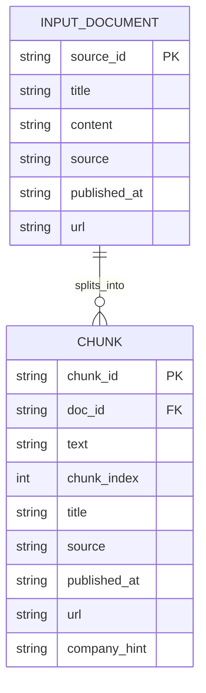
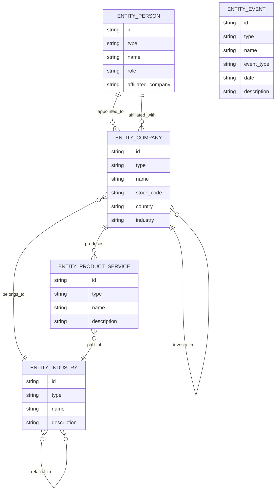
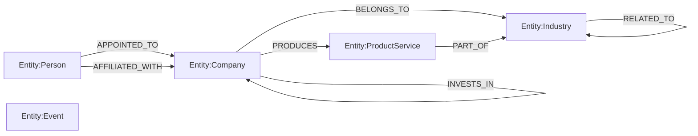

# Module B DB ER Diagram

Module B stores data in two different databases:

- ChromaDB: document chunks for vector retrieval
- Neo4j: entities and relationships for graph retrieval

Strictly speaking, the Neo4j side is a property graph rather than a classic RDB ER model. The diagram below is an ER-style logical model based on the code and schemas in this repository.

## 1. ChromaDB logical ER

This section starts from the input document schema that Module B receives from Module A.

Notes:

- `INPUT_DOCUMENT` is the input JSON schema passed from Module A to Module B.
- `INPUT_DOCUMENT` itself is not persisted as a separate DB table or collection in the current implementation.
- `CHUNK` is the logical record inserted into the Chroma collection `module_b_chunks`.
- `company_hint` is a search-assist metadata field. It is generated as a list in code, then stored as a comma-joined string in Chroma metadata.

## 2. Neo4j logical ER

This version is simplified for Notion Mermaid compatibility. It models only direct entity-to-entity relationships.

## 3. Actual graph interpretation in Neo4j

Internally, Module B loads Neo4j with:

- one shared base label: `Entity`
- one subtype label: `Company`, `Person`, `Event`, `Industry`, or `ProductService`
- typed relationships:
  - `ACQUIRES`
  - `INVESTS_IN`
  - `APPOINTED_TO`
  - `AFFILIATED_WITH`
  - `BELONGS_TO`
  - `PRODUCES`
  - `PART_OF`
  - `RELATED_TO`

Equivalent graph view:

Person role context is stored on the `APPOINTED_TO` or `AFFILIATED_WITH`
relationship. Person nodes store identity fields only, so the same person can
have different roles at different companies without node-level overwrites.

## 4. Implementation-based field summary

Input document fields:

- `source_id`
- `title`
- `content`
- `source`
- `published_at`
- `url`

Chroma chunk fields:

- `chunk_id`
- `doc_id`
- `text`
- `title`
- `source`
- `published_at`
- `url`
- `chunk_index`
- `company_hint`

Neo4j entity fields:

- common: `id`, `type`, `name`
- company: `stock_code`, `country`, `industry`
- person: `birth_ym`, `gender`, `main_career`
- event: `event_type`, `date`, `description`
- industry: canonical ids/names are normalized through `schemas/industry_taxonomy.json`; hierarchy remains Industry -> Industry via `PART_OF`
- product_service: `description`

Neo4j relation fields:

- `type`
- `from`
- `to`
- `evidence`
- role context fields for `APPOINTED_TO` and `AFFILIATED_WITH`
- evidence source fields attached during normalization

## 5. Design note

`source_id` exists in the graph JSON root, but the current Neo4j loader does not persist document-to-entity or document-to-relation provenance as a separate node/table. If you want, I can extend this into a v2 ERD that adds `Document`, `Chunk`, `Entity`, and `RelationEvidence` linkage for traceability.

## FTC affiliate groups

Module B also loads FTC affiliate-group reference data from `docs/ftc_affiliates.jsonl` without LLM extraction.

- node: `AffiliateGroup`
- relation: `Company -[:MEMBER_OF]-> AffiliateGroup`
- meaning: listed-company membership in an FTC designated business group, not ownership or parent/subsidiary structure
